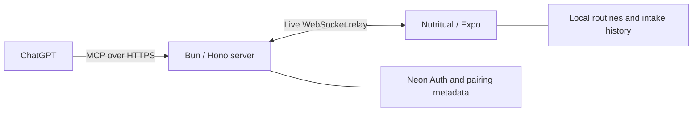

# Nutritual

Talk to ChatGPT about the supplements you take, then let it create your routines
in Nutritual. You don't have to enter each product by hand.

The goal is to set up products and reminder schedules through the conversation.
On your phone, you can see your routines, receive local reminders, and record
what you've taken.

> [!NOTE]
> **Under development.** I've demonstrated that ChatGPT can create a supplement
> routine directly in the app. I'm still building the full workflow, including
> reminder scheduling and routine listing through ChatGPT.

[Get started](#run-locally) · [Connect ChatGPT](docs/development.md#connect-chatgpt)
· [Architecture](#how-it-works) · [Development guide](docs/development.md)

## What you can do

| Action                                            | Phone app | ChatGPT        |
| ------------------------------------------------- | --------- | -------------- |
| Add a supplement routine                          | Yes       | As needed only |
| Choose weekdays or an interval                    | Yes       | Not yet        |
| Schedule local reminders                          | Yes       | Not yet        |
| Edit, delete, pause, or resume a routine          | Yes       | Not yet        |
| Record an intake, undo an entry, and view history | Yes       | Not yet        |

For example, ask ChatGPT to add a magnesium routine to Nutritual. After you
confirm the action in ChatGPT, it appears on the connected phone without
another approval in the app. An as-needed routine has no automatic reminder.

The app targets iOS first.

## How it works



The server authenticates the request and sends it to the paired phone. The phone
validates and saves the routine, then returns the outcome. Only one phone is
paired per user at a time.

Keep Nutritual open and connected when creating a routine through ChatGPT. The
server has no persistent command queue. If the phone is unavailable, reopen the
app and retry. If the outcome is unconfirmed, reuse the same operation ID.

### Your routine data stays on your phone

SQLite stores routines and intake history. The phone schedules reminders through
the operating system. Once scheduled, reminders don't need a ChatGPT conversation
or a live server connection.

Neon handles identity. Postgres stores pairing metadata, hashed device
credentials, short-lived relay tickets, and rate-limit counters. The server
doesn't persist routine commands or log their payloads. Supplement details you
share in ChatGPT still pass through ChatGPT and the relay during creation.

Reminders use local time. Interval reminders cover a finite set of future dates.
The app displays the last covered date and renews them when you reopen it.
Receiving a reminder never records an intake.

## Run locally

You'll need Bun, a Neon project with Managed Auth, and a Mac with Xcode for the
iOS development build. The ChatGPT connection also needs a free ngrok HTTPS endpoint
and a workspace that allows custom MCP apps and write actions.

1. Install dependencies from the repository root.

   ```sh
   bun install --frozen-lockfile
   ```

2. Follow the [development guide](docs/development.md) to configure Neon OAuth,
   the HTTPS origin, and the ignored `.env.local` file.

3. Start Expo and the server.

   ```sh
   bun run dev
   ```

4. In another terminal, install the development build on your connected iPhone.

   ```sh
   bun run --filter mobile ios:device "<device-name>"
   ```

The server listens on port `3000` by default.

## Repository

| Path                                               | Responsibility                                               |
| -------------------------------------------------- | ------------------------------------------------------------ |
| [`apps/mobile`](apps/mobile/README.md)             | Expo app, local storage, reminders, and phone authentication |
| [`apps/server`](apps/server/README.md)             | Hono server, OAuth pages, pairing, MCP, and live relay       |
| [`packages/protocol`](packages/protocol)           | Shared commands, validation, and delivery outcomes           |
| [`packages/oxlint-config`](packages/oxlint-config) | Shared lint rules                                            |

The workspace uses Bun, TypeScript, Expo, React Native, `@expo/ui`, Hono, the
official MCP SDK, and Neon Managed Auth.

## Further reading

- [Development guide](docs/development.md) for configuration, ChatGPT pairing,
  and common setup problems.
- [Domain glossary](GLOSSARY.md) for products, routines, intakes, and reminders.
- [Architecture decisions](docs/adr) for data ownership, authentication, and
  the single-process relay.
- [GitHub issues](https://github.com/ErwannRousseau/nutritual/issues) for specs
  and planned work.
